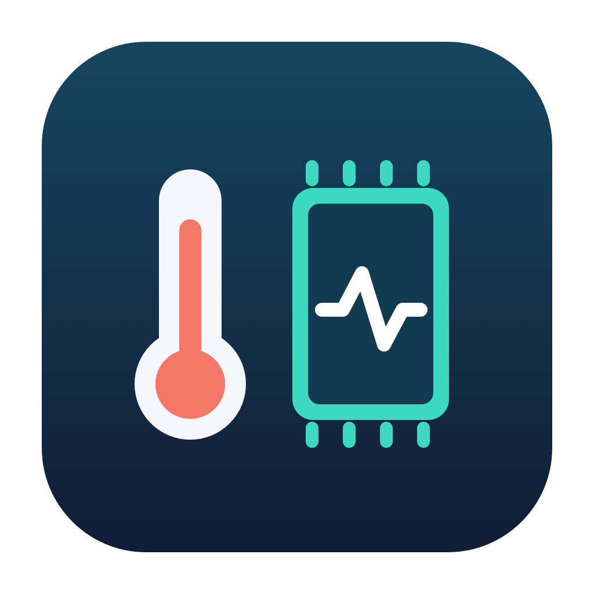
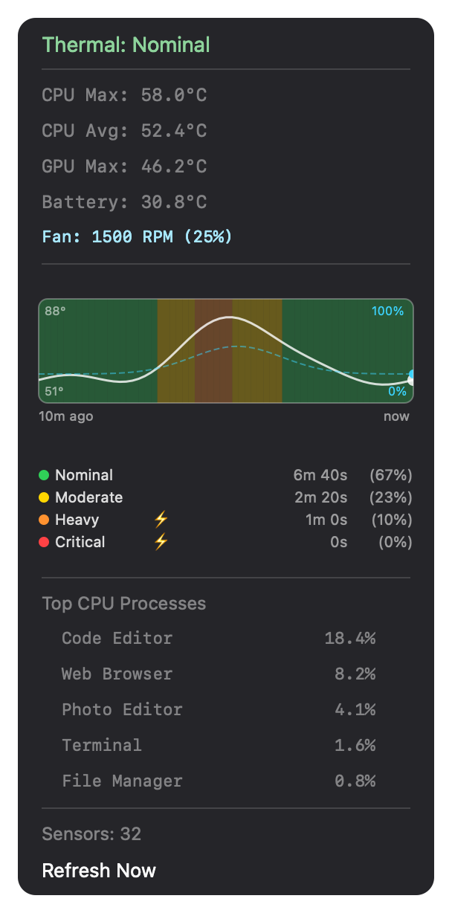
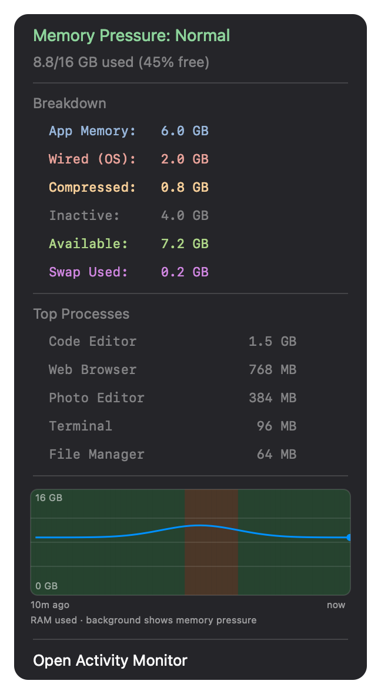
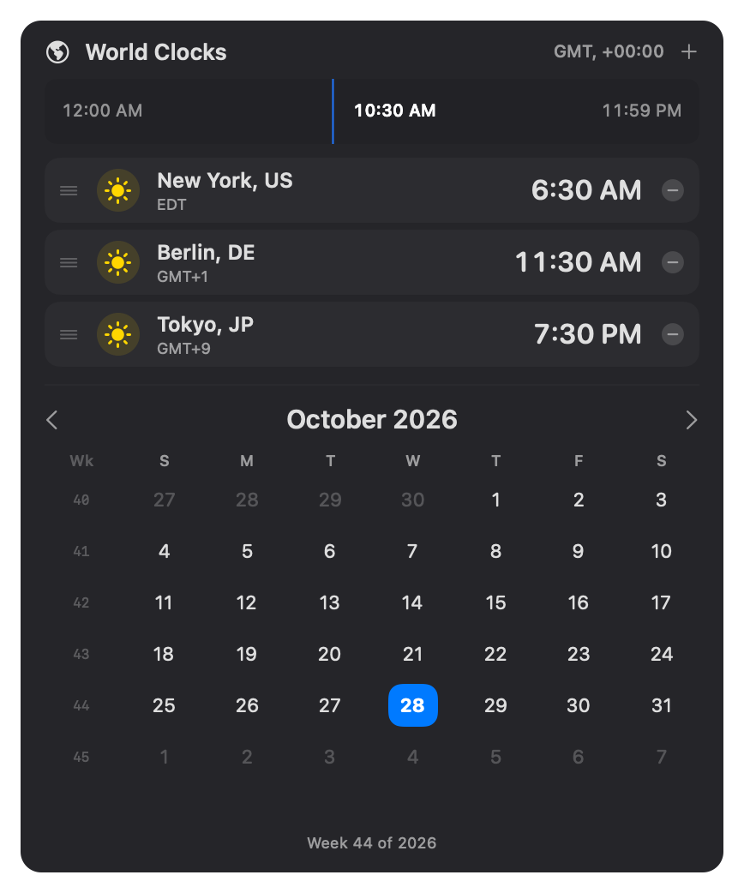
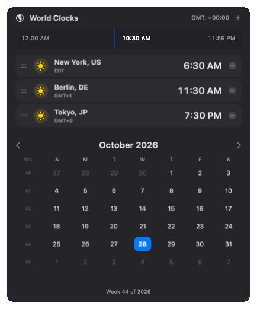

# Glance

<p>
  
  
</p>

Two independent, native macOS menu-bar apps. Install either app or both.

| App | Features |
|---|---|
| **Glance Monitor** | Memory pressure and breakdown, thermal pressure, CPU/GPU/battery temperatures, fan speed, history graphs, and top processes |
| **Glance Time** | World clocks, time scrubbing, inline add/remove/reordering, and a calendar with week numbers and Back to Today |

Neither app requires an account, browser, or remote service. They have separate
processes, preferences, and quit actions. Quitting one does not stop the other.

## Preview

App-rendered previews with synthetic data and neutral backgrounds, not desktop
captures. Monitor illustrates a fan-equipped Mac; process names and clock
settings are examples.

### Glance Monitor

| Thermal details | Memory details |
|---|---|
|  |  |

### Glance Time

| World clocks and calendar | Time scrubbing |
|---|---|
|  |  |

The clocks follow the selected time, including day/night and date changes, then
return to now when the scrubber is released.

## Requirements

- macOS 27 or later
- Xcode or Command Line Tools with the macOS 27 SDK and Swift 6.4 or later to build
- Temperature sensor support varies by Mac; the current SMC key mappings target
  Apple Silicon models

## Download

Download either app or both from [GitHub Releases](https://github.com/MJuma/Glance/releases).
Prebuilt downloads are for Apple Silicon Macs running macOS 27 or later. Extract
the ZIP and move the app to `~/Applications`.

The apps are ad-hoc signed, not Developer ID-signed or notarized. macOS Gatekeeper
may block downloaded copies; follow macOS trust prompts and your device's policies,
or build locally from source. SHA-256 checksums accompany each release.

## Build

```bash
swift test
swift -swift-version 6 Scripts/test-packaging.swift
bash Scripts/test-release-guards.sh
bash Scripts/build-apps.sh
```

The script produces two self-contained, locally ad-hoc-signed bundles:

```text
build/Glance Monitor.app
build/Glance Time.app
```

Launch the bundles rather than the bare executables:

```bash
open "build/Glance Monitor.app"
open "build/Glance Time.app"
```

The build script includes the MIT license and third-party notices in each bundle,
then validates its property list and ad-hoc signature in a fresh staging directory.
The complete bundle replaces the previous output atomically, so removed files
cannot remain in the next build. These are local
builds, not Developer ID-signed or notarized downloads; macOS Gatekeeper may block
copies distributed to another Mac. No developer account or upload is required.

## Install and remove

Build from source as above, then copy whichever app you want to `~/Applications`
using Finder. Quit an existing copy before replacing it, and launch the installed
bundle rather than its executable. Each app can be installed and removed
independently.

To start an app at login, add its installed bundle to macOS Login Items. Glance
does not register login items automatically. Avoid registering both the build
copy and an installed copy.

To uninstall, quit the app, remove its login item if present, and delete its
bundle. Saved world clocks at `~/.config/glance-clocks.json` and app preferences
are intentionally left in place. Monitor's sampled histories exist only in
memory and do not require disk cleanup.

For downloaded copies, follow macOS's normal trust prompts and your device's
policies; the project does not disable Gatekeeper or remove quarantine flags.
Building locally does not require an Apple developer account.

## Usage

**Monitor:** one menu-bar item shows thermal first, then memory and its usage
percentage. Each indicator is colored independently. Click for the combined
overview, **Thermal Details** and **Memory Details** submenus, refresh, or
**Quit Glance Monitor**.

Memory Details includes a ten-minute interactive RAM-usage graph on a fixed scale
of total physical memory. Background colors show sampled macOS memory pressure,
not inferred pressure from RAM utilization. Hover (or click and use arrow keys)
for used/available RAM, compressed memory, swap, pressure, and time. Sampling
remains every ten seconds; history is bounded and stays in memory.
Sampling continues during menu tracking; detail graphs show the snapshot taken
when their submenu opens. Available RAM is estimated from free plus inactive
pages, without adding overlapping speculative or purgeable counters.

**Time:** click the calendar-clock icon to open or close the menu. Drag the
scrubber to compare times, then release to return to now. Use the plus button to
search for a timezone, the minus buttons to remove clocks, and drag handles to
reorder them. **Quit Glance Time** is at the bottom of its menu.
Scrubbing selects a wall-clock time on the current local day, not an elapsed
number of seconds. Missing daylight-saving times normalize forward using the
calendar's transition; repeated times select the first occurrence. Clock rows,
day labels, and the scrubber label all use that same resolved instant. Local UTC
offsets include minutes for half-hour and quarter-hour timezones.

The calendar resets to the actual current date whenever it opens and updates
while open, including across midnight.

Both apps use a real status-item `NSMenu`, so AppKit handles positioning,
second-click toggling, Escape, and outside-click dismissal. Time's plus button
first ends menu tracking, then opens a separately interactive city picker;
adding a clock reopens Time. There are no custom click monitors, window-class
checks, timed action-suppression flags, or older-system fallbacks. Its clock model uses
Observation and stable row identities, with one timeline active while open.
Settings errors are shown in the menu; unreadable settings are not overwritten.
An unsupported saved timezone identifier is reported as a settings error rather
than silently displaying local time. Repair the preserved file and restart the
app to load it again.

Monitor releases detailed graph views after their menus close; Time releases its
menu and picker content when hidden. The status image is redrawn only when its displayed
status or appearance changes, using resolution-independent AppKit image drawing.
Monitor's thermal and memory graphs and thermal time-in-state breakdown use
native AppKit drawing, without application-owned SwiftUI hosting or Canvas.
The thermal graph preserves pressure bands, CPU temperature, dashed cyan fan
speed, and hover details. Click and use arrow keys to inspect samples with the
keyboard. Its lightweight drawn tooltip matches the memory graph rather than
adding a glass-effect view. Time continues to use SwiftUI for its menu and picker.
Thermal time-in-state percentages cover observed time only: a sample contributes
at most thirty seconds, excluding sleep and other long gaps. Observed unknown
pressure is included as its own row instead of disappearing from the breakdown.
Framework and allocator caches can still remain after either app's UI closes;
removing a hosting view does not guarantee a return to cold-start memory usage.

Top-process lists load asynchronously only when their detail menus open, with a
loading row and explicit error text. Closing a menu cancels its request and
terminates an outstanding child process. There is no process-list idle polling.

## Telemetry support

The project uses Swift 6 language mode and strict concurrency, with UI and mutable
monitor state owned by the main actor. Blocking subprocess work runs off that
actor. A small C target imports SDK headers for compiler-checked Darwin/IOKit
calls; no Swift declarations of C symbol names are used.

Detailed temperature/fan telemetry still depends on undocumented AppleSMC keys
and its protocol. The thermal notification key and memory-pressure sysctl are
also implementation-dependent. Those compatibility details are isolated in
`HardwareTelemetry.swift` and `Platform/`; using SDK-checked calls does not make
the underlying protocol public or guarantee support on future Macs.

Unavailable sensors are shown as unavailable, not zero degrees or absent fans.
Fan-specific UI is omitted when AppleSMC reports zero fans or the hardware model
identifies a known fanless Apple-silicon MacBook Air. Unknown models are not
assumed fanless when fan telemetry cannot be read.
Valid cold or negative temperature readings are retained; they are not discarded
by an arbitrary room-temperature minimum.
Failed memory sampling clears the current reading instead of presenting stale
data. If detailed thermal pressure fails, the app explicitly labels its use of
the public `ProcessInfo.thermalState` fallback; the two sources are not assumed
to have identical thresholds. Diagnostics log failure/recovery transitions, not
every failed poll. Memory pressure is never inferred from RAM utilization.

Run the optional live-hardware smoke check on a supported Mac with:

```bash
GLANCE_TEST_HARDWARE=1 swift test --filter localHardwareBridgeDecodesExpectedLiveReadings
```

## Local settings

| Location | Purpose |
|---|---|
| `~/.config/glance-clocks.json` | Saved clocks; preserves settings from previous local installations |
| `com.local.glance.monitor` preferences | Independent Monitor app preferences |
| `com.local.glance.time` preferences | Independent Time app preferences |

No user configuration files are included in this repository.

## Source layout

```text
Apps/GlanceMonitor/   Monitor app, system sensors, and graphs
Apps/GlanceTime/      Time app, clock model, original scrubber, unified calendar
Shared/              Small AppKit helpers and the sparkline buffer
Platform/            SDK-checked C bindings and isolated AppleSMC wire format
Tests/               Automated checks
Scripts/             Local app-bundle packaging
BuildTools/          Developer-only formatter, excluded from app dependencies
Assets/              Original generated app icons
```

## Development and release preparation

See [DEVELOPMENT.md](DEVELOPMENT.md) for strict checks, isolated Debug lifecycle
smoke tests, CI, icon generation, build identity and verified release archives.
Release tooling creates separate app ZIPs and SHA-256 checksums; the optional
GitHub workflow prepares drafts only. It does not add an app updater or require
an Apple developer account.

## License and acknowledgements

Glance is licensed under the [MIT License](LICENSE). See
[third-party acknowledgements and notices](THIRD_PARTY_NOTICES.md) for the
projects referenced by the original generic implementation. Their notices are
also included in packaged apps.

Glance is an independent project; these acknowledgements do not imply affiliation
with or endorsement by the referenced projects.
